# HSSP — Hospital Information System

A hospital information system for a general hospital of about 100 beds: emergency, ICU and care units, wards, operating theatre, pharmacy, laboratory, radiology, billing and administration. Each department works on its own board, and every patient is followed from admission to discharge.

> **The source code is private.** This repository only shows what the system does and how it is built. Everything on this page comes from a demonstration installation with **fictitious patients and staff**.

## Screenshots

### The nurse's day
Tasks to do is a card on the nurse's home screen. It turns red the moment a dose, an IV re-site or a STAT specimen is due and not charted yet.

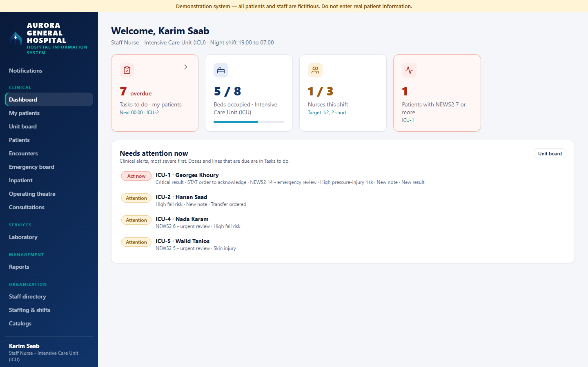

Opening the card gives a simple list: **when**, **where** (bed) and **what**, with a shift clock of one tile per hour. A task leaves the list by itself once it is charted in the patient's chart.

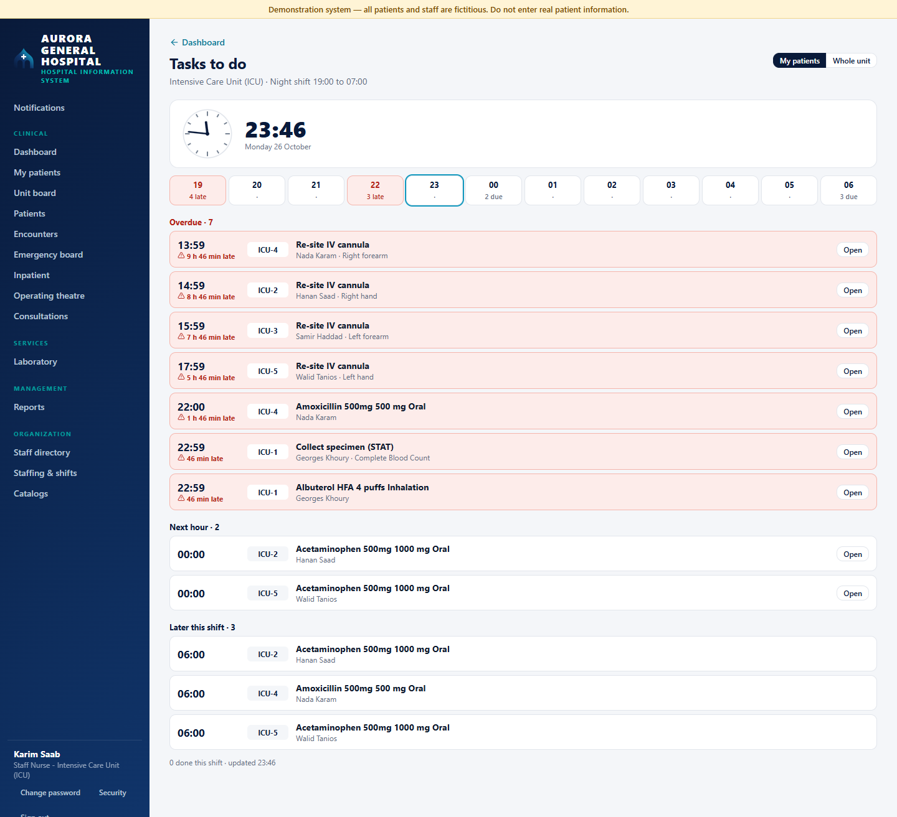

### The doctor's day
Critical results waiting for acknowledgement, consult requests, notes to sign, what came back in the last 24 hours, and the doctor's patients ordered by their early-warning score (NEWS2).

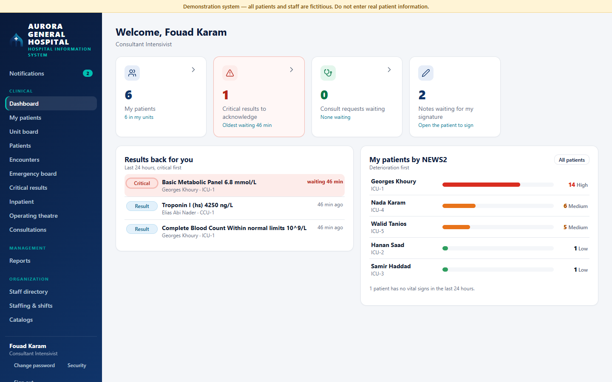

### Department boards and the patient chart

| ICU unit board | Medication administration record |
|---|---|
| 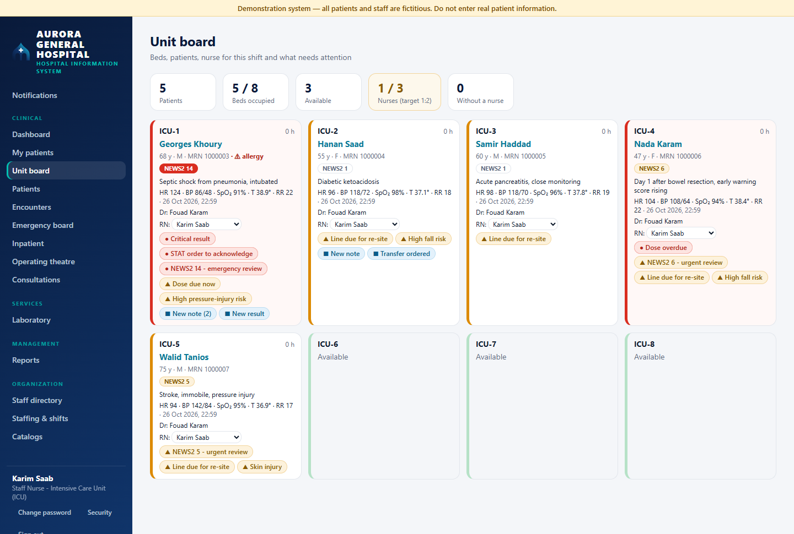 | 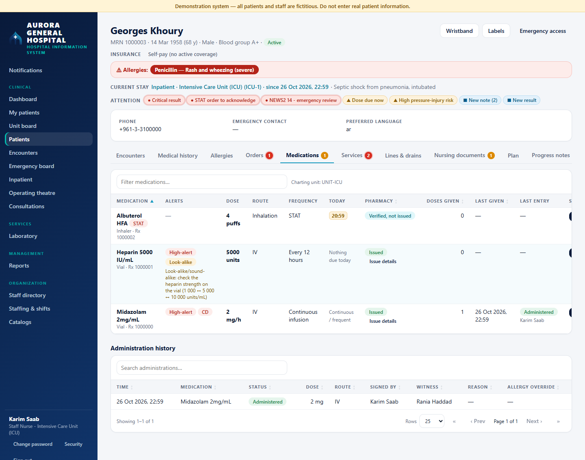 |
| Beds, attending doctor, nurse for the shift, latest vital signs and attention alerts, with staffing against the unit's nurse ratio. | Today's dose times (given, due, overdue), pharmacy verification state, allergy checks. |

| Vital signs and NEWS2 trends | Emergency board |
|---|---|
| 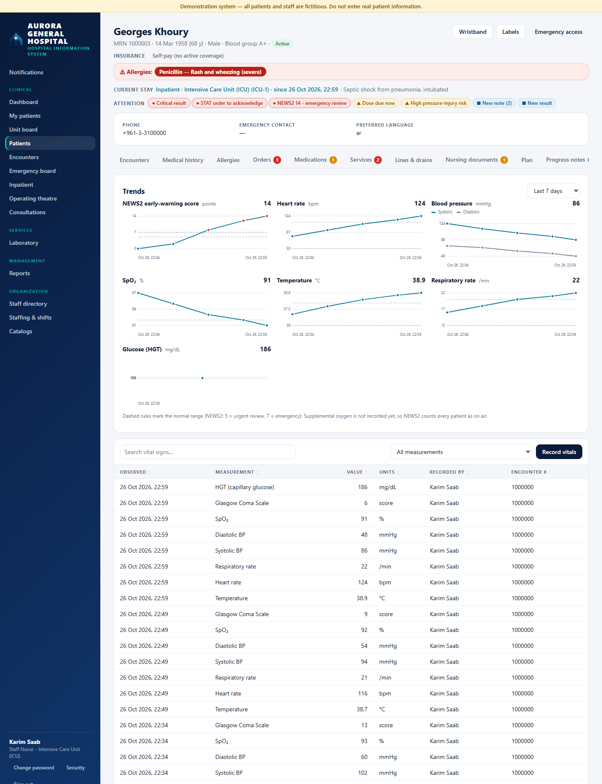 | 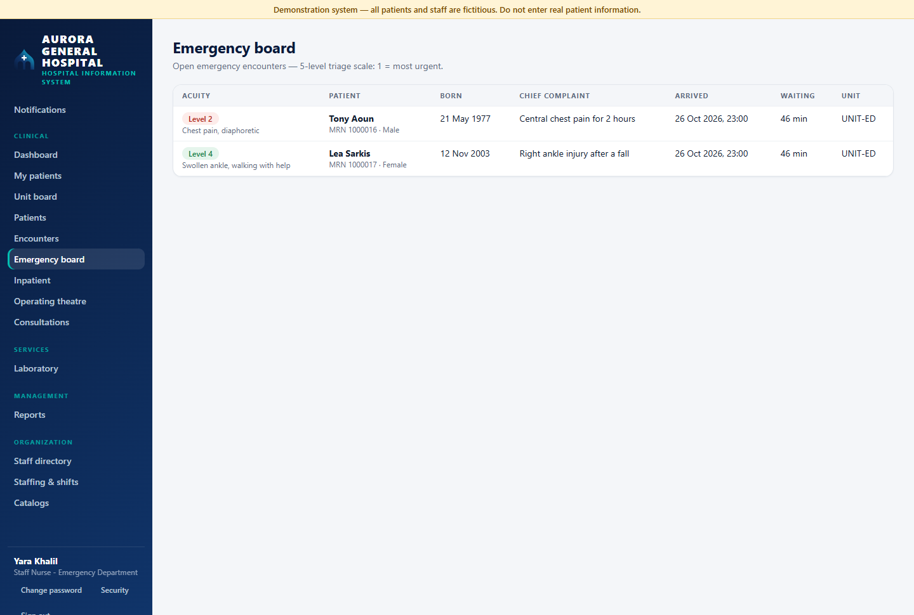 |
| Trend charts with the early-warning score curve. | Patients by triage level (ESI), waiting time, untriaged patients first. |

| Operating theatre | Hospital overview |
|---|---|
| 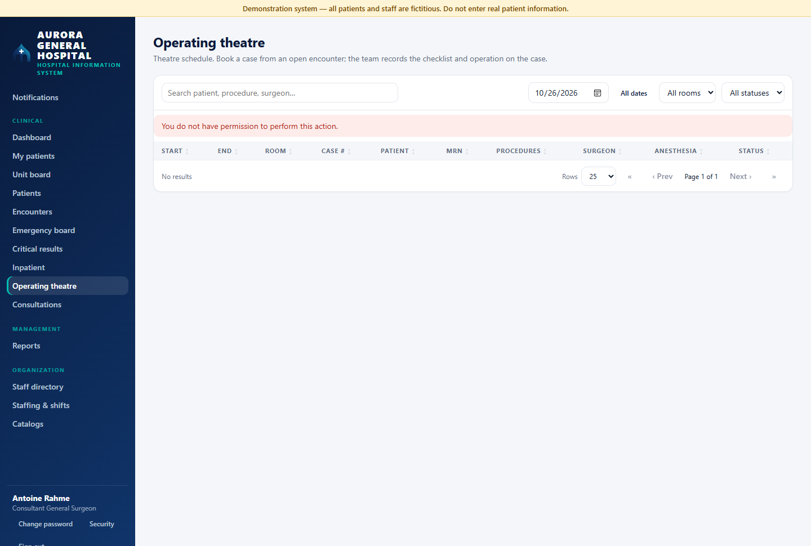 | 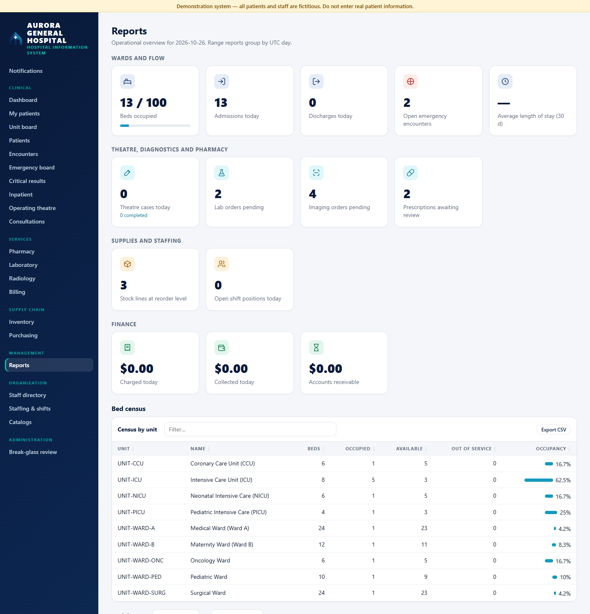 |
| Theatre list with the safety checklist that gates the start of a case. | Beds, admissions, theatre, diagnostics, stock, staffing and finance at a glance. |

| Pharmacy review | Laboratory worklist |
|---|---|
| 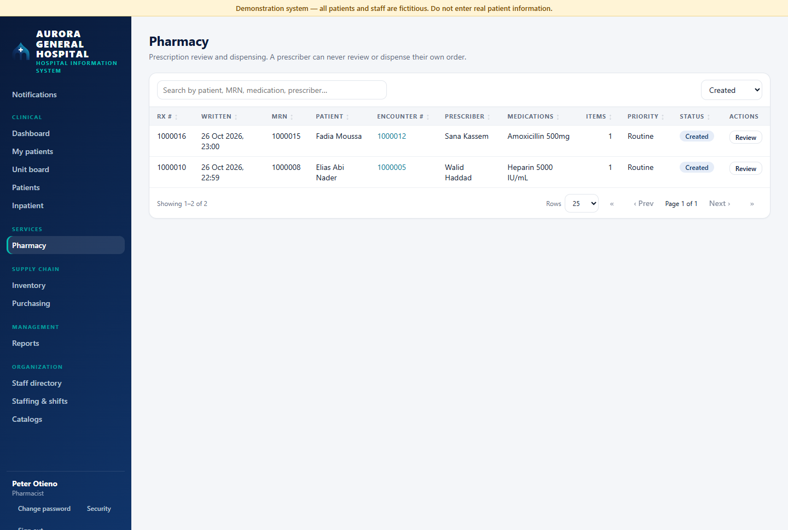 | 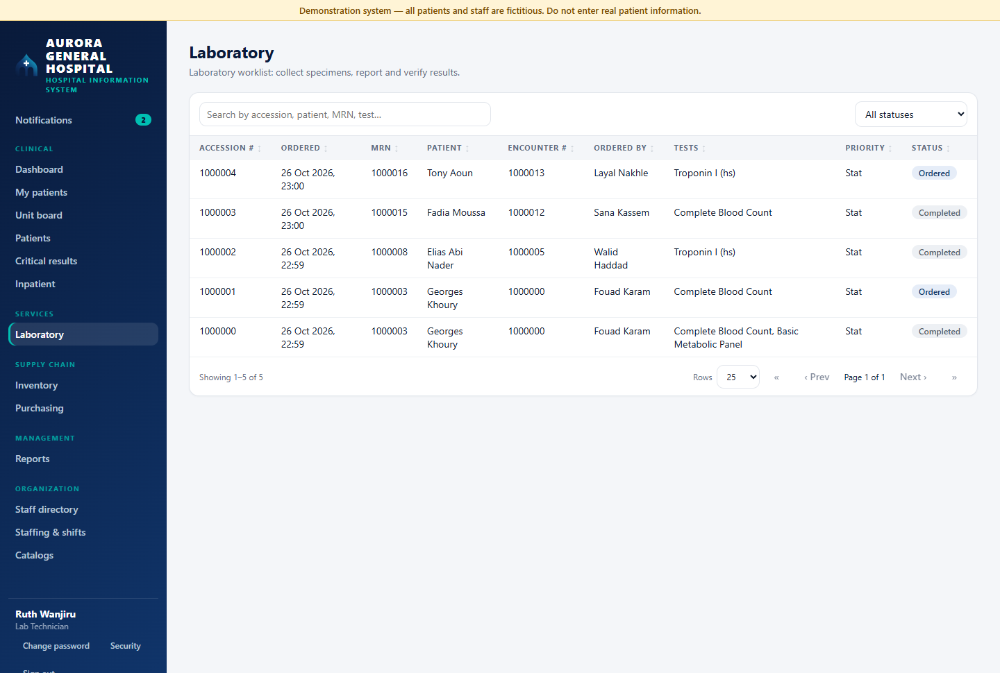 |
| A prescriber can never review or dispense their own order. | Orders to collect, process and verify. |

| Critical results | Patient registry |
|---|---|
| 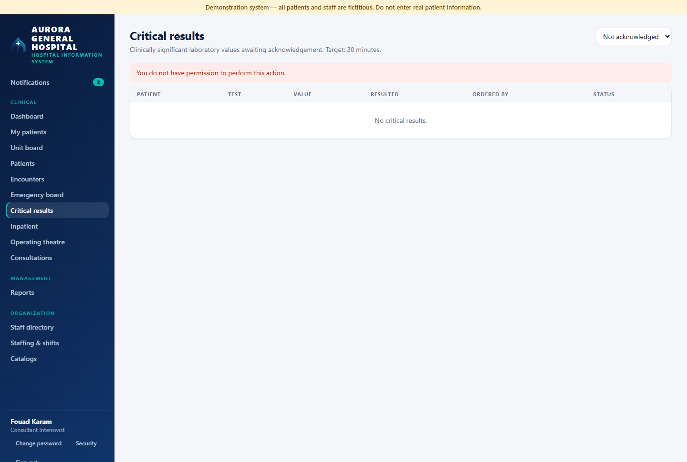 | 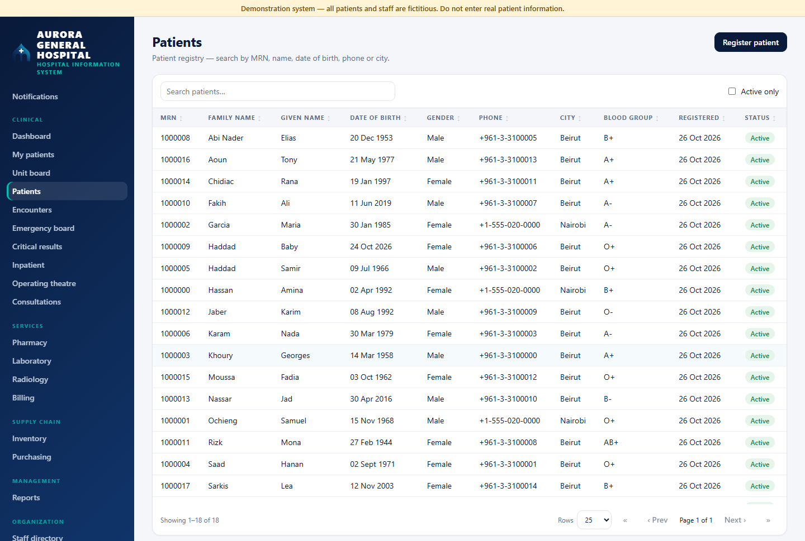 |
| Results that need a clinician's acknowledgement, with their age and the target. | Search by MRN, name, date of birth, phone or city. |

## How a shift works

1. **The nurse signs in** and lands on the dashboard: tasks that are due, beds and staffing of the unit, and the patients who need attention now.
2. **The head nurse assigns** a nurse to each patient for the shift. The assignment ends at the next shift change.
3. **A dose is charted** in the patient's chart. A STAT dose can only go ahead before pharmacy verification with a written reason, which pharmacy reviews afterwards.
4. **The doctor** is told at once when a critical laboratory result is entered. If nobody acknowledges it within the target time, it is escalated.
5. **A patient moves** between units through a transfer order: the other unit accepts, the handover is recorded, and the chart and access move with the patient. No re-registration.
6. **At discharge** the final bill is split between the insurer and the patient, according to the coverage the insurer pays.

## What it covers

- **Clinical:** patients and encounters, allergies, medical history, vital signs and NEWS2 early-warning score, progress notes, care plans, nursing assessments (falls, pressure injury, skin), lines and drains, consultations.
- **Departments:** ICU, CCU, NICU, PICU, medical, surgical, paediatric and maternity wards, oncology and emergency, each with its own board. The hourly ICU flowsheet records fluid balance.
- **Surgery:** theatre booking, WHO safety checklist, pre-operative checklist, intra-operative record and recovery scoring.
- **Medication:** prescribing, pharmacy review and dispensing, the nursing administration record with a second signature for controlled drugs.
- **Diagnostics:** laboratory with critical-result acknowledgement and escalation, radiology with insurer approval for CT and MRI.
- **Business side:** charges, invoices, payments, insurers with coverage shares, inventory, purchasing, staff rosters, reports.

## Safety, privacy and control

- **Access follows the patient's care.** Staff see their own department's patients and the patients they are responsible for. Everyone else needs a justified emergency access, which is reviewed afterwards.
- **Everything is audited.** Every view and change is recorded in an append-only log.
- **Separation of duties.** The person who prescribes is not the person who verifies; the person who orders is not the person who approves.
- **Accounts:** hashed passwords, forced change of temporary passwords, lockout and rate-limited sign-in, optional second factor.
- **Alerts are derived, not typed in.** Overdue doses, critical results, high NEWS2, fall risk and lines due for re-site are computed from the chart itself.

## Architecture

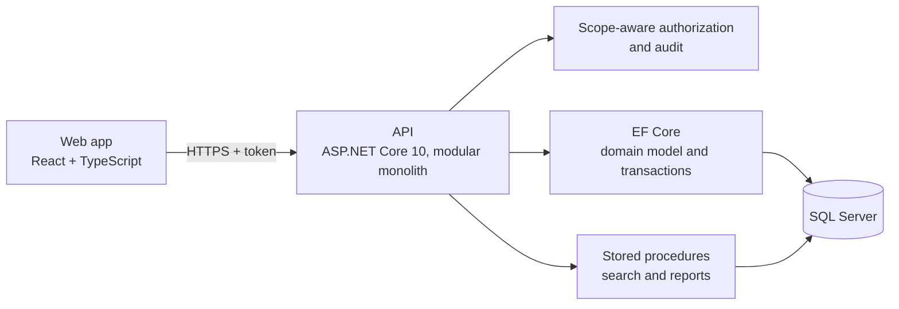

| Layer | Technology |
|---|---|
| Web app | React 19, TypeScript, Vite |
| API | ASP.NET Core 10 minimal APIs, organised by bounded context |
| Database | SQL Server; EF Core for the model and transactions, stored procedures for every search and report |
| Quality | About 180 integration tests that run the real API against a real SQL Server database; continuous integration on every change |
| Deployment | Docker Compose for the demonstration installation |

## More in this repository

| | |
|---|---|
| [How it works, role by role](docs/how-it-works.md) | What the nurse, doctor, pharmacist, laboratory and billing see and do. |
| [Architecture](docs/architecture.md) | Layers, principles and one request end to end. |
| [Safety, privacy and control](docs/safety-and-privacy.md) | Who sees what, what is recorded, the safety nets. |
| [Glossary](docs/glossary.md) | NEWS2, MAR, ESI, SBAR, break-glass and the other terms. |
| [Roadmap](docs/roadmap.md) | Ideas for what comes next. |
| [`assets/`](assets) | The product mark and a social preview image. |

## Status

A portfolio project built to the standard of a real product, and still growing. It runs on demonstration data only. It is **not a certified medical device and must not be used for patient care**.

## About

Built by **Anas Fawaz**. For a walkthrough or questions, get in touch through my GitHub profile.

## Copyright

© Anas Fawaz. All rights reserved. The source code is private and is not licensed for copying, modification or redistribution. The screenshots and text in this repository may be shared with credit.
