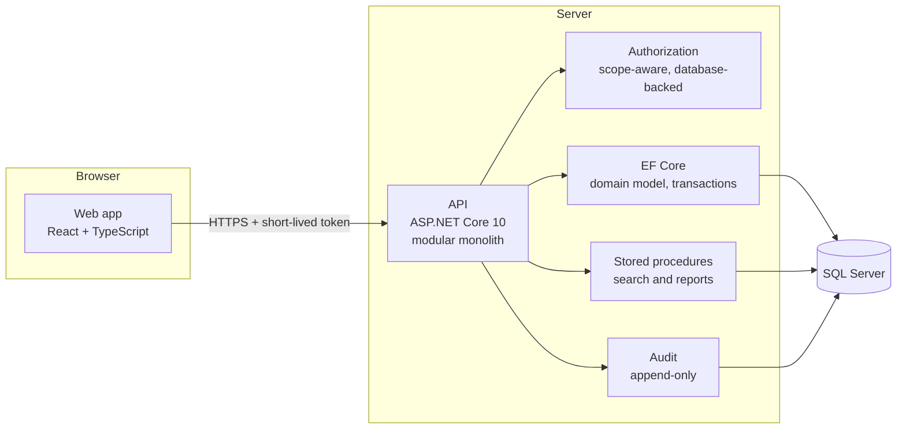
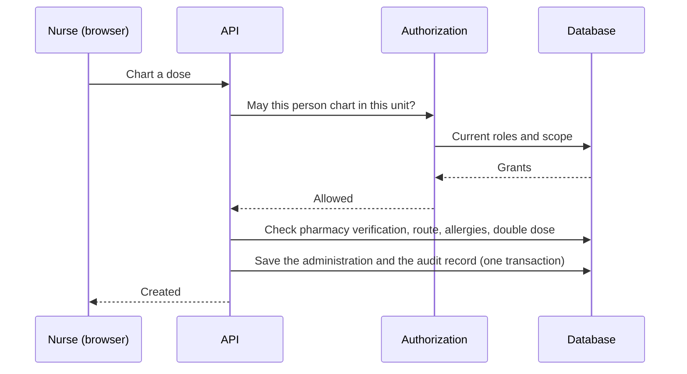

# Architecture

## Principles
- **The patient is the centre.** Every clinical workflow hangs off the patient's stay (the encounter): orders, doses, results, notes, lines, scores.
- **A modular monolith.** One deployable API, organised by bounded context (access, patients, clinical, inpatient, surgery, diagnostics, pharmacy, finance, supply chain, workforce, reporting).
- **The server decides.** The web app only hides what a user may not do. Every request is authorized again on the server, against the user's current roles and scope.
- **Derived, not duplicated.** Alerts, early-warning scores, dose schedules and the dashboards are computed from the chart when asked. Nothing is typed in twice, so nothing can drift.
- **Searches in the database.** Every listing and report is served by a versioned stored procedure, with search-as-you-type and safe sorting. The database layer is owned and versioned separately from the application code.
- **History is kept.** Records are corrected by amendment, not overwritten. The audit trail is append-only.

## One request, end to end

## The dashboards
One call returns the home screen of the signed-in user, shaped by their role: the nurse's tasks and unit, the doctor's patients and results, or the general work queues. The screen refreshes every minute and the clock moves on its own, so a task turns red on the minute without reloading.

## Quality
- Integration tests host the real API against a real SQL Server database (migrations and seed included), so every rule is tested the way it runs.
- The pipeline builds with warnings as errors, checks that the database migrations are in sync, runs the tests and lints the web app on every change.
